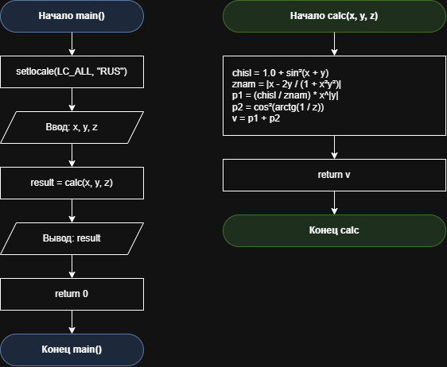

# Домашнее задание к работе 5

## Условие задачи
При x = 3.74 * 10 в степени -2
y = –0.825
z = 0.16 * 10 в степени 2
Получить: 1.0553
В выражении для вычисления варианта 3
(https://drive.google.com/file/d/1wvWm5s72psbTkr7SI4fySPSxPmfLrM7f/view)

## 1. Алгоритм и блок-схема

### **Алгоритм**
1. **Начало**
2. Подключить необходимые библиотеки:
   - `<locale.h>` - для работы с локалью (поддержка русского языка).
   - `<stdio.h>` - для ввода и вывода данных (printf, scanf).
   - `<math.h>` - для использования математических функций (pow, sin, cos, atan, fabs).
3. Объявить прототип функции `double calc(double x, double y, double z)` для расчёта значения математического выражения.
4. Определить функцию `main()` - точку входа в программу:
   - Объявить переменные типа double: `x`, `y`, `z` (входные параметры) и `result` (результат).
   - Установить локаль для корректного отображения кириллицы: `setlocale(LC_ALL, "RUS")`.
5. Запросить у пользователя и считать с клавиатуры исходные вещественные значения `x`, `y`, `z` с помощью функции `scanf`.
6. Вызвать функцию `calc(x, y, z)`, передав ей считанные значения параметров `x`, `y` и `z`.
7. В теле функции `calc(double x, double y, double z)`:
   - Объявить переменные типа double: `chisl`, `znam`, `p1`, `p2`, `v`.
   - Вычислить числитель дроби: `chisl = 1.0 + pow(sin(x + y), 2)`.
   - Вычислить знаменатель дроби: `znam = fabs(x - (2.0 * y) / (1.0 + pow(x, 2) * pow(y, 2)))`.
   - Рассчитать первое слагаемое: `p1 = (chisl / znam) * pow(x, fabs(y))`.
   - Рассчитать второе слагаемое: `p2 = pow(cos(atan(1.0 / z)), 2)`.
   - Вычислить итоговое значение `v = p1 + p2` и вернуть его в вызывающую функцию.
8. В функции `main()` сохранить возвращённое значение в переменную `result`.
9. Вывести на экран значение `result` с форматированием до четырёх знаков после запятой (`printf`) и завершить работу функции `main()`, вернув 0.
10. **Конец**

### Блок-схема
 

[https://github.com/stzraw/lab-5-VSTU-HW/blob/main/lab_5_schema%20(1).png](https://github.com/stzraw/lab-5-VSTU-HW/blob/main/lab_5_schema.pravki.png)

## 2. Реализация программы

#define _CRT_SECURE_NO_DEPRECATE
#include <stdio.h>
#include <stdlib.h>
#include <locale.h>
#include <math.h>

double calc(double x, double y, double z);

int main()
{
    double x, y, z;
    double result;

    setlocale(LC_ALL, "RUS");

    printf("Введите x: ");
    scanf("%lf", &x);

    printf("Введите y: ");
    scanf("%lf", &y);

    printf("Введите z: ");
    scanf("%lf", &z);

    result = calc(x, y, z);

    printf("Результат v = %.4f\n", result);
    return 0;
}

double calc(double x, double y, double z)
{
    double chisl, znam, p1, p2, v;

    chisl = 1.0 + pow(sin(x + y), 2);
    znam = fabs(x - (2.0 * y) / (1.0 + pow(x, 2) * pow(y, 2)));

    p1 = (chisl / znam) * pow(x, fabs(y));
    p2 = pow(cos(atan(1.0 / z)), 2);

    v = p1 + p2;
    return v;
}

## 3. Результаты работы программы

Введите x: 0.0374
Введите y: -0.825
Введите z: 16
Результат v = 1.0553

## 4. Информация о разработчике

Быханов Александр Андреевич бИД - 262 2пг

